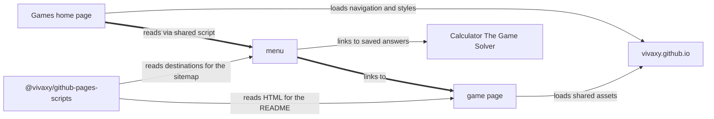

# Games architecture

## Core diagram

Arrows point to dependencies. The bold path follows a player opening a game from
the Games home page.

## Components

| Component                                                                                                             | Responsibility                                                                                              | Depends on                                                                                                   |
| --------------------------------------------------------------------------------------------------------------------- | ----------------------------------------------------------------------------------------------------------- | ------------------------------------------------------------------------------------------------------------ |
| [Games home page](../index.html)                                                                                      | Opens the collection at `/games/`.                                                                          | The menu plus the scripts and stylesheet supplied by vivaxy.github.io.                                       |
| [vivaxy.github.io](https://github.com/vivaxy/vivaxy.github.io/blob/c574030d52483ea27d487c9f042171fa336b6d91/index.js) | Its shared navigation script reads `menu.json` relative to the current page and renders one link per entry. | The menu for the current collection.                                                                         |
| [menu](../menu.json)                                                                                                  | Supplies the link label, destination and display order.                                                     | Each entry's relative URL resolves to a game page or the saved solver answers.                               |
| [game page](../15-puzzle/index.html)                                                                                  | Loads the scripts, styles and assets for one game.                                                          | Game-specific files and any shared assets referenced by its HTML.                                            |
| [Calculator The Game Solver](../calculator-the-game-solver/index.js)                                                  | Reads the levels and writes solutions that players can open directly.                                       | The level definitions and action parser in the solver directory.                                             |
| [`@vivaxy/github-pages-scripts`](../package.json)                                                                     | Generates the README and sitemap through the [pre-commit hook](../.husky/pre-commit).                       | HTML metadata and the `gps` configuration for the README, menu destinations and Git history for the sitemap. |

## Main flows

1. **Play a game.** The Games home page loads `/index.js`. The script requests
   the menu and uses each entry's `name` as link text and `link` as its URL.
   Choosing a game opens its game page.
2. **Read a solver answer.** The Calculator The Game Solver entry opens the
   saved [answers.json](../calculator-the-game-solver/answers.json). Running the
   solver is a separate development step.
3. **Generate the Table of contents.** `gps toc` visits game directories with an
   `index.html`, reads their HTML metadata and writes the root
   [README](../README.md) with the configured introduction and link prefix. The
   solver's JSON entry falls outside that HTML scan.

## Related decisions

- [Documentation boundaries](adr/2026-11-25-documentation-boundaries.md) records
  where the player introduction is maintained.
